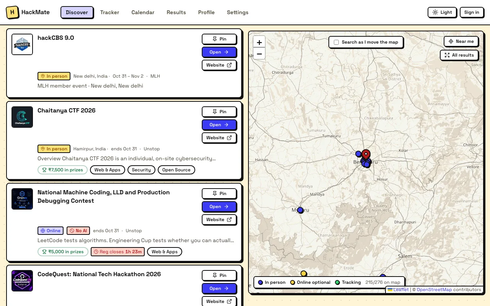
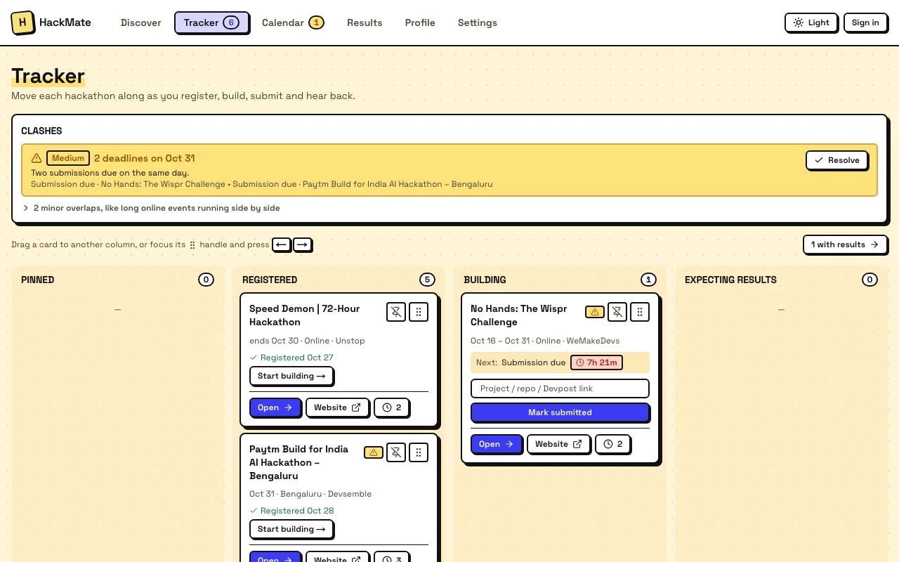
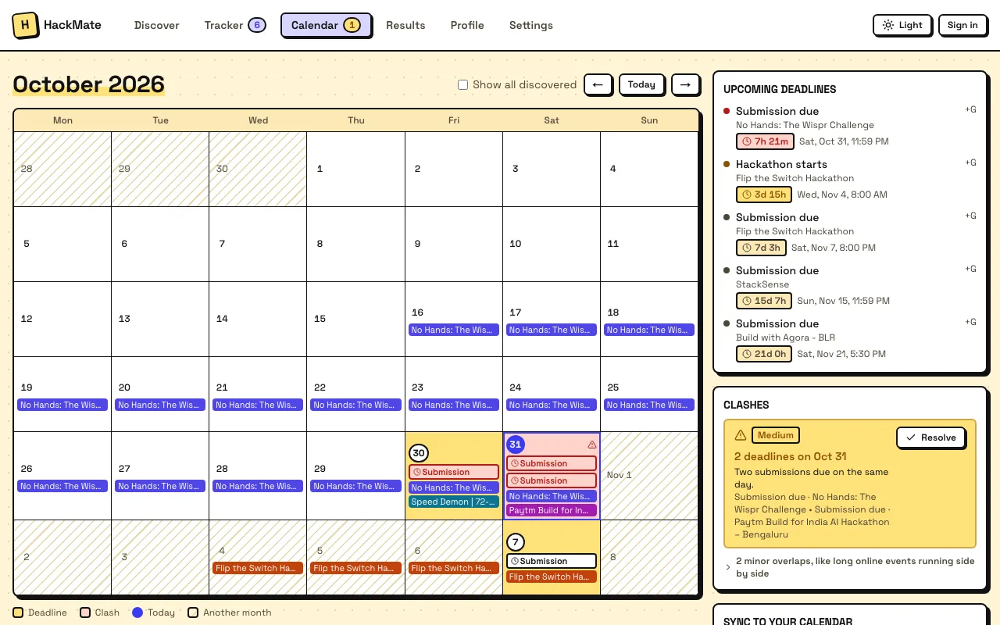

# HackMate

HackMate keeps track of the hackathons you enter: finding ones you can still join, pinning them, following their
deadlines, and recording how they went.

Built for **No Hands: The Wispr Challenge** by voice with Wispr Flow, then trimmed down to what I use.

**Live:** https://hackmate-pied.vercel.app



| | |
| --- | --- |
|  |  |
| **Tracker:** each entry's stage, next deadline and clashes. | **Calendar:** deadlines, clashes and countdowns, with calendar sync. |

## What's in it

**Discover** pulls upcoming hackathons from **Unstop**, **Devfolio**, **MLH**, **WeMakeDevs**, **Devpost**,
**lablab.ai**, **HackerEarth**, **Hack2skill**, **Devsemble** and **Devnovate** into one list, and leaves out
the ones you can no longer join: finished events, closed registrations, and in-person events that have already
started.
- **Dates:** pick a day on the calendar to see hackathons from today until then, or two days to see only the ones
  that start and end between them.
- **Sort** by what happens next, registration closing, biggest prize, or team size (smallest or largest first).
  Each card shows its team size ("Solo", "Team 2–4").
- **Filters** for format, city, prize, length and free entry. Every theme and source starts on; click one to hide
  hackathons with it. A map with a near-me view.
- Each card's title and **Website** button open the hackathon's own page.
- **Add from link** reads a Hack2skill, Unstop or Devnovate event (or any page, with AI); **Add manually** for
  anything else.

**Tracker:** pin a hackathon, then move it through *Pinned → Registered → Building → Submitted* by dragging.
Registration close, start and submission dates come from the listing; you can edit them or add your own.
**Wrap up** records the result, prizes and certificate, and moves it to Results.

**Calendar:** every tracked deadline in a month view. Clashes (two in-person events on the same days, deadlines
on the same day) are ranked and can be marked resolved. Subscribe from Google, Apple or Outlook, or download an
`.ics` file. **Email reminders** go out before each deadline (1 week / 3 days / 1 day / 3 hours / 1 hour).

**Results and Profile:** finished hackathons by year, prizes (won → claimed → paid), a certificate vault, stats
(win rate, prize money, monthly activity) and a public profile. **People** lists everyone with an account.

## Running it

Needs Node 22.13+. Uses Postgres through `DATABASE_URL`, or an embedded PGlite database for local development.

```bash
npm install
npm run dev
```

Open http://localhost:3000. The first load pulls all ten feeds (a few seconds). After that they refresh every 6
hours, or on demand with **Refresh feeds**. Map coordinates are filled in from OpenStreetMap in the background.

With no `DATABASE_URL`, local data lives in `data/pg` (git-ignored). See `DEPLOY.md` for hosted Postgres and
deployment.

- **AI (optional):** `GROQ_API_KEY` and/or `GEMINI_API_KEY` in `.env.local` let **Add from link** read pages
  that aren't from a known site. Everything else works without them.
- **Email reminders:** fill in the SMTP details from `.env.example` (a Gmail app password works). Without SMTP,
  reminders go to the **Outbox** on the Settings page instead.
- **Calendar sync:** Google and Outlook fetch the feed from their servers, so they need HackMate at a public URL.

## How it's built

- **App:** Next.js 16 (App Router) and React 19, deployed on Vercel.
- **Data:** Postgres on Supabase, with row-level security: each request only sees the signed-in account's rows,
  enforced by the database.
- **Scheduled jobs:** Supabase's scheduler calls `/api/cron` every 5 minutes for reminders and feed refreshes.
- **Tests:** `npm test`, including a fuzz test that sends broken and hostile input to every API route.

## How the feeds are read

| Source | How |
| --- | --- |
| Unstop | public search API (`/api/public/opportunity/search-result`) |
| Devfolio | public search API (`api.devfolio.co/api/search/hackathons`) |
| MLH | event JSON embedded in the season events page |
| WeMakeDevs | hackathon cards embedded in the `/hackathons` page |
| Devpost | public hackathon listing JSON, with pagination and explicit date-range parsing |
| lablab.ai | hackathon records embedded in the public listing's React Server Component data |
| HackerEarth | public Compete API, limited to hackathons that have not ended |
| Hack2skill | public event listing API, with pagination |
| Devsemble | public `get-all-hackathons` API, limited to published events |
| Devnovate | the public events JSON its site reads (`devnovate.co/api/v1/events`), approved hackathons only; organisers' contact fields are never read or stored |

Discover groups duplicate event listings across platforms and keeps the alternate platform links.
Matching uses event URLs, normalized names, dates, and locations. City editions and different years
stay separate. Pinned identities take precedence, and adding the same event through another platform
does not create a second tracker entry. Grouping does not delete source rows, notes, or deadlines.
A new source automatically triggers an initial refresh on an existing installation.

None of these are official, documented APIs, so a site redesign can break a source. A failing source is
reported on the Discover page, and the others keep working. Adapters live in `src/lib/sources/`.

## Stack

Next.js 16 (App Router) · React 19 · Tailwind CSS 4 · Postgres / PGlite · Leaflet + OpenStreetMap · Nodemailer · Groq + Gemini

## Regression checks

```bash
npm test
npm run lint
npx tsc --noEmit
npm run build
```

The regression suite uses Node's test runner and the existing TypeScript dependency.
It creates an isolated in-memory Postgres database and disables AI credentials and SMTP for the test process.
Your saved database, uploads, and environment files are not used.
The tests cover saving partial updates, request validation, discovery filters, calendar alerts,
the date range, closed registrations, team-size sorting, and concurrent reminder delivery.
